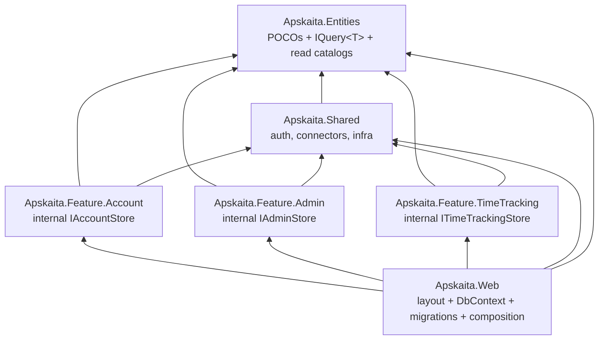

# Architecture: Vertical Slices with a Shared Data Core

Status: approved direction, staged implementation
Date: 2026-10-13
Owner: Apskaita

## 1. Goal and non-goals

**Goal.** Split Apskaita into feature assemblies (vertical slices) with compile-time-enforced
ownership: each feature owns its write access, publishes read contracts, and never reaches into
another feature's data. UI, services, and slices live per feature.

**Non-goals (for now).**
- No per-feature `DbContext` and no per-feature migration histories — one context, one pipeline
  (single deploy → independent-deployability payoff does not exist yet).
- No CQRS bus, no repository/specification framework, no DKNet adoption.
- No microservices, no separate databases.

**The one rule that makes it work.** A feature touches other features' data only through the
read-only generic contract `IQuery<T>` published in `Apskaita.Entities` — inject
`IQuery<Project>`, `IQuery<User>`, ... and compose LINQ directly against the entity. Write
capability (`IStore` with `DbSet`) is declared *inside* the owning feature assembly and is
`internal` — only the feature itself and the composition layer (`Apskaita.Web`) can use it.

## 2. Dependency direction



- Features reference `Entities` + `Shared` only — never each other, never the concrete `DbContext`.
- `Shared` references `Entities` (or nothing) — never a `DbContext`, never an `IStore`.
- `Web` references everything: it is the composition root that implements the private stores.

## 3. Target project layout with class names

### 3.1 `Apskaita.Entities` — POCOs + shared read contracts (no `DbContext`)

```
Apskaita.Entities/
  Entities/
    BaseEntity.cs            (existing)
    User.cs                  (existing)
    Company.cs, CompanyInfo.cs, Client.cs, Issuer.cs, Unit.cs, Project.cs,
    InvoiceTemplate.cs, Invoice.cs, InvoiceLine.cs, InvoiceSequenceState.cs,
    WorkAct.cs, WorkActLine.cs, SystemSettings.cs, TimeTracking.cs,
    CalendarConnector.cs, CalendarEventReference.cs   (existing)
    FieldLengths.cs          (existing)
  Contracts/                 (NEW)
    IQuery.cs                → public interface IQuery<TEntity> where T : class
                              { IQueryable<TEntity> All(); }   // no-tracking by contract
  ── REMOVED from this project (see 3.6): ApskaitaDbContext.cs, Mapping/*, DataAccessServiceCollectionExtensions.cs
```

Notes:
- No named catalog interfaces and no DTO records. Cross-feature reads inject `IQuery<TEntity>`
  directly and compose LINQ against the entity (`IQuery<Project>`, `IQuery<User>`, ...). One
  generic contract, zero per-feature plumbing types.
- Accepted trade-offs: entity shape is visible across feature lines (schema refactors ripple
  through consumers — compile-safe in one repo), and `IQuery<User>` exposes every column
  including the password hash. If that ever becomes unacceptable, add a DTO catalog for that
  one table — nothing else changes.

### 3.2 `Apskaita.Shared` — infrastructure, provider connectors (NEW project)

Absorbs `Apskaita.Web.Shared` and `Apskaita.Web/Shared/*`, `Apskaita.Web/Logging/*`,
`Apskaita.Web/Features/Account/Authentication/*`.

```
Apskaita.Shared/
  Routing/
    FeatureUri.cs            → IFeatureUri, HttpFeatureUri        (from Web.Shared/Routing)
  Auth/
    AuthPolicies.cs          (from Web.Shared)
    AccountCookieEvents.cs   (from Web/Features/Account/Authentication)
    EntraIdConnectSetup.cs   (OIDC provider config helpers, from Web/Setup.cs where extractable)
  Calendar/
    ICalendarProviderConnector.cs, CalendarProviderInfo.cs          (existing, from Web/Shared/Calendar)
    CalendarConnectorRegistry.cs                                     (existing)
    Outlook365Connector.cs                                           (existing; now depends on
                                                                       ICalendarConnectorTokenStore, not the store class)
    CalendarEventReader.cs   → ICalendarEventReader + reader         (existing)
    ConnectorAuthOptions.cs                                          (existing)
    ConnectorTokenProtector.cs                                       (existing)
    ICalendarConnectorTokenStore.cs   (NEW abstraction — Shared defines, Feature.Account implements:
                                       GetTokensAsync/SaveTokensAsync/ClearAsync by connector id)
  Ui/
    AdminNavItem.cs          (from Web.Shared)
    ProjectColorCatalog.cs   (from Web.Shared/ProjectColors)
  Web/
    BrowserTimeZone.cs       (from Web/Shared)
    RequestLoggingMiddleware.cs   (from Web/Logging)
    ExternalCallLoggingHandler.cs (from Web/Logging)
  SharedServicesCollectionExtensions.cs   (NEW: services.AddApskaitaShared(...))
```

`Shared` must not reference `ApskaitaDbContext` or any `IStore`. It may reference `Entities`
POCOs/records (e.g. `CalendarEventReference`).

### 3.3 `Apskaita.Feature.Account` (NEW project; absorbs `Apskaita.Web/Features/Account`)

```
Apskaita.Feature.Account/
  Persistence/
    IAccountStore.cs         → internal interface (write capability, Account-only):
                                { DbSet<User> Users { get; } DbSet<CalendarConnector> Connectors { get; } }
                                [InternalsVisibleTo("Apskaita.Web")] on the assembly.
    AccountConnectorTokenStore.cs → internal, implements Shared.ICalendarConnectorTokenStore over IAccountStore
  Endpoints/
    AccountEndpoints.cs      (moved from Web; registered under /account)
    UsersEndpoints.cs        (MOVED from Admin's UserRegistry — Account owns the users table, so
                              Account hosts the admin user-management UI; registered under the
                              /admin/users route group; nav placement under the Admin group is a
                              NavigationItem concern, not an assembly concern)
    ConnectorEndpoints.cs    (connector connect/disconnect/read-events actions, moved with the feature)
  Services/
    AccountProvisioner.cs    (existing)
    AccountContentService.cs (existing; absorbs connector page-model creation from Web)
    CalendarConnectorStore.cs (MOVED from Web/Shared/Calendar — now uses IAccountStore, not DbContext)
  Models/                    (existing Account + connector view models)
  Slices/                    (_Page.cshtml, _LoginPage.cshtml, _PendingPage.cshtml,
                             _ConnectorsTable.cshtml, connector dialogs)
  Validators/                (if any)
  FeatureAccountServices.cs  (NEW: public static IServiceCollection AddFeatureAccount(this IServiceCollection)
                              — registers internal impls: ICalendarConnectorTokenStore; the
                                IAccountStore→context adapter is registered by Web)
```

### 3.4 `Apskaita.Feature.Admin` (rename/move of `Apskaita.Feature.Admin`)

```
Apskaita.Feature.Admin/
  Persistence/
    IAdminStore.cs           → internal interface:
                                { DbSet<Client> Clients, DbSet<Issuer> Issuers, DbSet<Unit> Units,
                                  DbSet<Project> Projects, DbSet<InvoiceTemplate> InvoiceTemplates,
                                  DbSet<Company> Companies, DbSet<SystemSettings> SystemSettings,
                                  DbSet<Invoice> Invoices, DbSet<InvoiceLine> InvoiceLines,
                                  DbSet<InvoiceSequenceState> InvoiceSequenceStates,
                                  DbSet<WorkAct> WorkActs, DbSet<WorkActLine> WorkActLines }
                                (invoices/work-acts stay Admin-owned until a Feature.Invoicing exists)
  ClientsRegistry/  IssuerRegistry/  UnitRegistry/  ProjectRegistry/
  InvoiceTemplateRegistry/  SystemConfig/   (existing folder layout kept:
    Endpoints/ Models/ Services/ Slices/ Validators/)
    ClientsEndpoints.cs, IssuersEndpoints.cs, UnitsEndpoints.cs, ProjectsEndpoints.cs,
    InvoiceTemplatesEndpoints.cs, SystemSettingsEndpoints.cs   → switched to IAdminStore
    (UserRegistry/ folder is REMOVED — UsersEndpoints moves to Feature.Account, see 3.3)
  Common/                    (existing Models/Slices)
  FeatureAdminServices.cs    (NEW: AddFeatureAdmin(...) — no catalog impls needed; IQuery<T> comes from Web)
```

### 3.5 `Apskaita.Feature.TimeTracking` (NEW project; absorbs `Apskaita.Web/Features/TimeTracking`)

```
Apskaita.Feature.TimeTracking/
  Persistence/
    ITimeTrackingStore.cs    → internal interface: { DbSet<TimeTracking> Entries { get; } }
  Endpoints/
    TimeTrackingEndpoints.cs (moved; project-lookup endpoints switch from db.Projects to IQuery<Project>,
                              user display names from IQuery<User>)
  Services/
    TimeTrackingContentService.cs (moved)
  Models/                    (moved: row models, search/query records, upsert requests)
  Slices/                    (moved: _ListPage, _Grid, _CreateDialog, _EditDialog, _DeleteConfirm, lookup slices)
  Validators/                (moved: TimeTrackingModelValidator)
  FeatureTimeTrackingServices.cs (NEW: AddFeatureTimeTracking(...))
```

### 3.6 `Apskaita.Web` — host, layout, composition root, data

```
Apskaita.Web/
  Program.cs, Setup.cs       (Setup.cs shrinks: pipeline + auth config + wiring calls)
  Data/
    ApskaitaDbContext.cs     (MOVED from Entities; implements nothing — plain context, IDataProtectionKeyContext kept)
    ApskaitaDbContextFactory.cs (MOVED from Apskaita.Data.Migration — design-time for `dotnet ef` against Web)
    Mapping/                 (MOVED from Entities: ApskaitaEntityModelBuilderExtensions.cs, MySqlEnumTypeExtensions.cs)
    Migrations/              (MOVED from Apskaita.Data.Migration; namespace updated)
    DataAccessCollectionExtensions.cs (NEW/absorbed: AddApskaitaData(...) — AddDbContext, MigrateAsync-at-startup helper)
  Composition/               (implements the features' internal stores; needs InternalsVisibleTo grants)
    AccountStore.cs          → sealed class AccountStore(ApskaitaDbContext db) : Feature.Account.IAccountStore
                                { public DbSet<User> Users => db.Set<User>(); public DbSet<CalendarConnector> Connectors => db.Set<CalendarConnector>(); }
    AdminStore.cs            → : Feature.Admin.IAdminStore (db.Set<T>() per table)
    TimeTrackingStore.cs     → : Feature.TimeTracking.ITimeTrackingStore
    QueryImpl.cs             → sealed class Query<TEntity>(ApskaitaDbContext db) : IQuery<TEntity>
                                { public IQueryable<TEntity> All() => db.Set<TEntity>().AsNoTracking(); }
    CompositionServices.cs   → AddScoped<IAccountStore, AccountStore>(), AddScoped<IAdminStore, AdminStore>(),
                                AddScoped<ITimeTrackingStore, TimeTrackingStore>(),
                                AddScoped(typeof(IQuery<>), typeof(Query<>))
  Layout/                    (stays: _Layout.cshtml, _SideNav.cshtml, AppFeaturePageRenderer.cs, Models/)
  wwwroot/                   (stays: css/site.css, js/*, icons/)
```

**Retired projects:** `Apskaita.Data.Migration` (absorbed into `Web/Data`), `Apskaita.Web.Shared`
(merged into `Apskaita.Shared`). `Apskaita.Entities` loses `ApskaitaDbContext`, `Mapping/`, and
`DataAccessServiceCollectionExtensions`.

## 4. Table ownership map

| Table | Owner (`IStore`) | Cross-feature read surface |
|---|---|---|
| `users` | Account (also hosts the `/admin/users` UI) | `IQuery<User>` |
| `calendar_connectors` | Account | none (Account UI only) |
| `clients`, `issuers`, `units`, `projects`, `invoice_templates`, `companies`, `system_settings` | Admin | `IQuery<T>` per table as needed |
| `invoices`, `invoice_lines`, `invoice_sequence_states`, `work_acts`, `work_act_lines` | Admin (until `Feature.Invoicing`) | none yet |
| `time_trackings` | TimeTracking | none yet |
| `data_protection_keys` | Web host (infrastructure) | n/a |

## 5. Contract rules

1. `IQuery<T>.All()` is **no-tracking by contract** (`AsNoTracking()` in `Query<T>`). Tracked
   entities must never cross a feature line — with a shared context, a tracked entity mutated by a
   consumer would be silently persisted by the owner's next `SaveChanges`.
2. Owner-facing `IStore` exposes mutable `DbSet` (tracked, writes allowed) and is `internal` to the
   feature assembly + `[InternalsVisibleTo("Apskaita.Web")]` — misuse is a compile error, not a
   review finding.
3. Cross-feature reads compose server-side (`Where`/`OrderBy`/`Select`/`Skip`/`Take`) over
   injected `IQuery<TEntity>` so `ListRequest` paging/sort and lookup endpoints keep translating
   to one SQL query.
4. There is no cross-feature write path. If a feature needs to mutate another feature's data
   (e.g. admin user management), the *owning* feature hosts the endpoint and registers it under
   the required route group — writes never cross an assembly line.
5. `Shared` never references `Entities`' `DbContext`-related code or any `IStore`.
6. Every table has exactly one `IStore` owner.

## 6. DI wiring (end state, `Setup.cs`)

```csharp
services.AddApskaitaData();                    // Web/Data: DbContext + Query<T> + store adapters
services.AddApskaitaShared();                  // Shared: connectors, logging, FeatureUri, policies
services.AddFeatureAccount();                  // token store (+ UsersEndpoints under /admin/users)
services.AddFeatureAdmin();                    // registry content services
services.AddFeatureTimeTracking();
services.AddFeature<TimeTrackingEndpoints>("/time-tracking");   // existing AddFeature<T> pattern
services.AddFeature<AccountEndpoints>("/account");
services.AddFeature<ClientsEndpoints>("/admin/clients");
// ... existing registrations unchanged
```

## 7. Staged implementation

Each stage ends green: `dotnet build Apskaita/Apskaita.slnx` + `dotnet test --project tests/Apskaita.Tests/Apskaita.Tests.csproj` (107 tests) + app boots.

| Stage | Work | Validation |
|---|---|---|
| **0. Baseline** | Current tree builds/tests green (done 2026-10-13: 107/107) | — |
| **1. Contracts** | Add `Contracts/IQuery.cs` to `Apskaita.Entities` + `Query<T>` impl and open-generic registration in Web. No behavior change. | build + tests |
| **2. `Apskaita.Shared`** | New project; move `Web.Shared` (FeatureUri, AuthPolicies, AdminNavItem, ProjectColorCatalog), `Web/Shared/*` (Calendar/*, BrowserTimeZone), `Web/Logging/*`, `AccountCookieEvents`. Add `ICalendarConnectorTokenStore`; refactor `Outlook365Connector` to depend on it (keep `CalendarConnectorStore` temporarily in Web as a stop-gap implementation). Delete `Apskaita.Web.Shared`. | build + tests + connector smoke |
| **3. Account pilot** | New `Apskaita.Feature.Account`; move `Web/Features/Account/*` + `CalendarConnectorStore` + Admin's `UsersEndpoints` (re-registered under `/admin/users`); declare internal `IAccountStore` + IVT; `AccountStore` adapter + `Query<T>` in Web/Composition; implement `AccountConnectorTokenStore`. Web registers everything. | build + tests + `/account` and `/admin/users` smoke |
| **4. Admin** | Rename `Apskaita.Feature.Admin` → `Apskaita.Feature.Admin`; declare internal `IAdminStore`; switch all registry endpoints/services from `ApskaitaDbContext` to `IAdminStore`. | build + tests + admin pages smoke |
| **5. TimeTracking** | New `Apskaita.Feature.TimeTracking`; move feature; internal `ITimeTrackingStore`; switch lookups to `IQuery<Project>`/`IQuery<User>`. | build + tests + grid/dialog smoke |
| **6. Data move** | Move `ApskaitaDbContext`, `Mapping/`, `Migrations/`, design-time factory into `Web/Data`; retire `Apskaita.Data.Migration`; strip `Entities` to POCOs+contracts; regenerate migrations if namespace churn requires. | build + tests + fresh-DB `MigrateAsync` run |
| **7. Hardening (optional)** | Remove the four `DisableAntiforgery()` calls in TimeTracking endpoints (header hook fixed 2026-10-13); clean recursive `artifacts/build-temp` output loops in Web + Admin. | tests + POST smoke |

Stage 3 is the pilot: if the pattern proves out on Account, stages 4–5 are mechanical.

## 8. Project-reference gotchas (verified in this repo)

- Feature classlibs with `.cshtml` slices need `FrameworkReference Microsoft.AspNetCore.App`,
  `RazorSlices` package, and the generator project-ref with
  `OutputItemType="Analyzer" ReferenceOutputAssembly="false" PrivateAssets="all"`.
- Static web assets from classlibs serve under `/_content/<AssemblyName>/...` (Admin already relies on this).
- `Directory.Packages.props` central management applies to all new projects; keep versions out of csproj.
- `dotnet ef` commands target `Apskaita.Web` after stage 6 (`--project src/Apskaita.Web`).
- Tests keep referencing `Apskaita.Web` (WebApplicationFactory); run via
  `dotnet test --project tests/Apskaita.Tests/Apskaita.Tests.csproj` from `Apskaita/`.

## 9. Acceptance criteria

1. No feature assembly references `ApskaitaDbContext`, another feature, or any EF write API
   (`DbSet`, `Add`/`Update`/`Remove`) outside its own `Persistence/` folder.
2. `IAccountStore`, `IAdminStore`, `ITimeTrackingStore` are `internal`; only `Apskaita.Web`
   (via `InternalsVisibleTo`) implements them.
3. All cross-feature data access goes through injected `IQuery<T>`; `IQuery<T>.All()` is
   no-tracking; no feature writes another feature's tables.
4. One `DbContext`, one `Migrations` folder, one `MigrateAsync` at startup; zero behavior change
   to routes, HTMX responses, or the 107 tests.
5. `Apskaita.Data.Migration` and `Apskaita.Web.Shared` no longer exist; solution builds clean.
