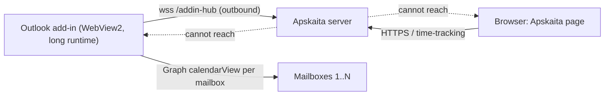
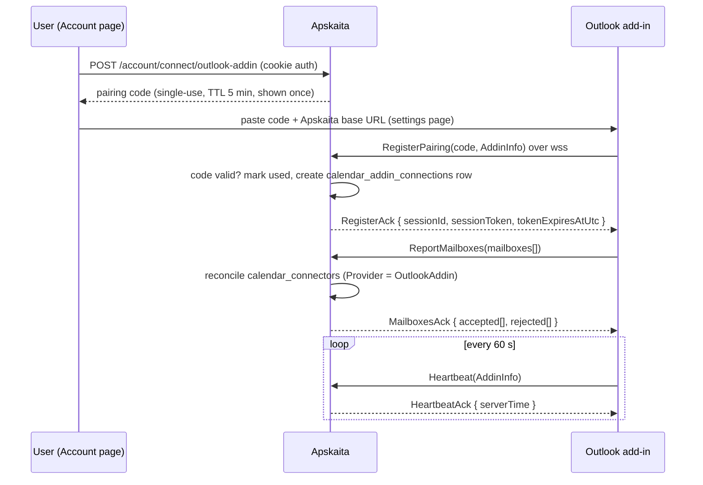
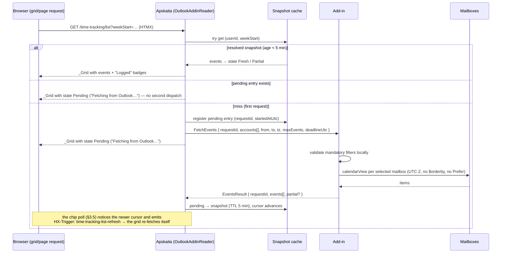
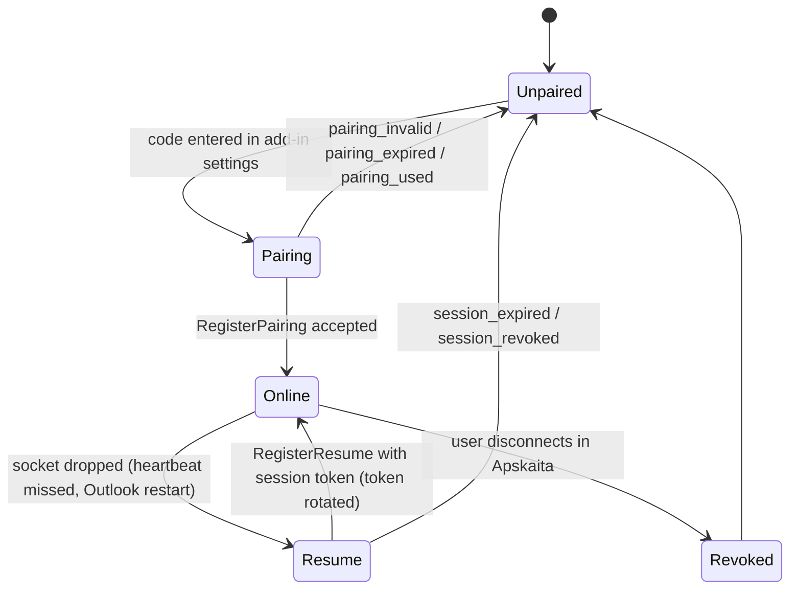
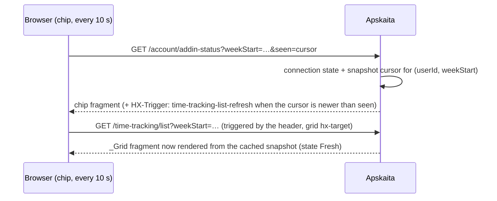

# Introduction


Connect the **Outlook desktop/web client** to Apskaita through a JavaScript add-in that keeps a
long-lived **SignalR** session to the server. The server cannot reach the user's machine, but the
add-in can always reach the server, so the channel is used **in reverse**: the server pushes a
*fetch request* (accounts + date range, both mandatory) down the socket, the add-in executes it
against each selected mailbox using the add-in's own authenticated mailbox sessions, and returns
the events. Apskaita caches the result briefly and renders the existing `_CalendarPanel` from it.

Why not the previously discussed designs:

| Option | Verdict |
|---|---|
| VSTO/COM add-in hosting an HTTP listener | **Impossible** on the target client. The user's Outlook reports `1.2026.1001.200` / client `20261002003.17` / `WebView2 155.x` / `Seanso ID` — that is **new Outlook for Windows**, which has no COM object model, no VSTO, no VBA. |
| Companion local agent reading Outlook via COM | Same blocker, plus an installer, a listening port, `urlacl`/admin issues, and Chrome PNA / Firefox localhost blocking. **Dropped.** |
| Graph connector (existing `Outlook365Connector`) | Kept as-is for server-owned mailboxes. It cannot see mailboxes that only exist in the user's Outlook profile — that is exactly the gap this feature fills. |
| **JS add-in + SignalR reverse channel** | **Chosen.** No port, no installer, no localhost trust problems, and the same code runs in OWA and classic Outlook. |

No changes are required in the time-tracking feature: the event identity triple
`("OutlookAddin", accountKey, externalEventId)`, `GET /time-tracking/event`, the dedupe index and
the create/edit dialogs all work unchanged once a connector row exists for the account.

## 1. Requirements & Constraints

- **REQ-001**: The add-in registers a persistent SignalR connection to Apskaita using a **pairing code** generated by the Account connector card plus the **Apskaita base URL** configured in the add-in's settings page.
- **REQ-002**: A successful pairing yields a **session token** (TTL 60 min, rotated on every reconnect/resume). The pairing code is never the long-lived credential.
- **REQ-003**: The add-in reports its visible mailboxes (`accountId`, `accountKey`, `label`, `primary`, `restApiHost`) on connect and whenever the set changes; Apskaita reconciles `calendar_connectors` rows for provider `OutlookAddin` from that report.
- **REQ-004**: The server can request events with `accounts[]`, `from`, `to` — **all mandatory**. `accounts` is non-empty, ≤ 10 entries, every key must belong to the session owner; `from`/`to` are ISO dates, `from ≤ to`, span ≤ 31 days.
- **REQ-005**: The add-in enforces the same validation locally before touching Outlook (a malformed request must never reach the mailboxes) and answers exactly one `EventsResult` per `requestId`.
- **REQ-006**: Events are fetched per selected mailbox from that mailbox's own REST endpoint (`{restApiHost}/v1.0/me/calendarView`) with the established Graph rules: UTC boundaries with an escaped literal `'Z'` + `InvariantCulture`, `id` in `$select`, **no `$orderby`**, **no `Prefer: timezone` header**.
- **REQ-007**: Returned events map to `CalendarEventInfo` with `ProviderKey = "outlook-addin"`, `AccountKey = ownerEmail.ToLowerInvariant()`, `EventId = graph id` (skip items with blank or > 255-char id — they render inert, same rule as identity-less Graph events).
- **REQ-008**: The time-tracking panel reads events from a **snapshot cache** (per user + displayed week), never from a live socket, and **never blocks on the add-in**. A cache miss dispatches one fetch and renders immediately in the `Pending` state (§3.4/§3.5); the arriving result renews the grid through the browser state channel. A pending entry older than `PendingDeadlineSeconds` (30 s) resolves to `FetchFailed`.
- **REQ-009**: The panel's click flow (`GET /time-tracking/event`), the owned `CalendarEventReference`, the unique index and the "Logged" badge are unchanged; this feature only adds a new provider source.
- **REQ-010**: One transport per account: when an `OutlookAddin` connector row exists for an `accountKey`, the Graph reader must skip that account (prevents the same event appearing twice under two provider keys).
- **REQ-011**: The add-in works **headless** — the socket must survive the task pane being closed (shared runtime with `"lifetime": "long"`). If long-running is unavailable on a client, the add-in shows "keep the Apskaita pane open" and the feature degrades to manual re-sync.
- **REQ-012**: Connection lifecycle is observable in the UI: connected / offline-since / add-in version / mailbox list / last sync, with disconnect revoking the session immediately.
- **REQ-013**: The panel's calendar state is explicit, not inferred: `CalendarSourceState` ∈ `NoConnector | AddinOffline | Pending | FetchFailed | Partial | Fresh` is part of `TimeTrackingPageModel`, and "No events this week." renders **only** under `Fresh`. A degraded source never claims the week is empty.
- **REQ-014**: The add-in connection state is visible without visiting the time-tracking page: a status chip on the Account page and in the `_CalendarPanel` header (paired / online / offline-since / version / account count / last seen), refreshed by the poll in §3.5.
- **REQ-015**: A late `EventsResult` (arriving after the grid already rendered `Pending`) renews the grid through the existing `time-tracking-list-refresh from:document` trigger — no new client-side rendering path and no HTML pushed over a socket.
- **REQ-016**: One in-flight fetch per `(userId, weekStart)`: concurrent requests for the same week (grid, chip poll, adjacent-week prefetch, a second tab) attach to the existing pending entry instead of dispatching another `FetchEvents`.
- **REQ-017**: The browser state channel is a **polled fragment** (`hx-trigger="every 10s"`, htmx core — no extension, no JS file). Push transports (SSE, `hx-signalr`) are rejected for v1 per DEC-004 (§3.6).
- **SEC-001**: Pairing code: 128-bit random, 5-minute TTL, **single-use**, stored hashed; issuance requires an authenticated Apskaita session with `AuthPolicies.Operational`.
- **SEC-002**: Hub connections are origin-checked. Allow-list (configurable): `https://outlook.office.com`, `https://outlook-sdf.office.com`, `https://officeapps.live.com`, and the new-Outlook packaged origin. No `Access-Control-Allow-Origin: *`.
- **SEC-003**: Every `EventsResult` is untrusted input: length caps (subject/location/organizer ≤ 200, `eventId` ≤ 255, `accountKey` ≤ 254), ≤ 500 events, dates must fall inside the requested window, unknown accounts dropped and logged.
- **SEC-004**: Only calendar metadata is transferred (subject, times, location, online flag, organizer). No message bodies, no attachments, no credentials. Event data is cached in memory only and never persisted.
- **SEC-005**: Session tokens are bound to (user, connection row, reported mailbox keys). A request for an account the user does not own is rejected server-side (`mailbox_denied`) even if the add-in claims it can see it.
- **CON-001**: `CalendarProvider` gains `OutlookAddin` **appended** (MySQL `enum` column definition changes on two tables; see §5).
- **CON-002**: `CalendarConnector` is reused unchanged for `OutlookAddin` rows; `RefreshTokenProtected` and `Scopes` stay NOT NULL and are written as empty strings for this provider (no token exists — the add-in holds the auth).
- **CON-003**: Migrations live in `src/Apskaita.Web/Data/Migrations` (namespace `Apskaita.Data.Migrations.Migrations`); generate with `dotnet build src/Apskaita.Web/Apskaita.Web.csproj` first, then `dotnet ef migrations add <Name> --project src/Apskaita.Web --no-build` (MySQL on `127.0.0.1:3306` must be running for `ServerVersion.AutoDetect`).
- **CON-004**: `Apskaita.Shared/Calendar` keeps the contracts (`ICalendarEventReader`, `CalendarEventInfo`, `ICalendarEventReferenceResolver`); the new reader lives beside `Outlook365Connector` in the app's `Shared/Calendar` folder.
- **CON-005**: Feature modules are singletons; scoped services (hub, store, reader) must be endpoint/delegate-registered, never constructor-injected into a singleton feature.
- **PAT-001**: Follows the existing connector pattern: `ICalendarProviderConnector` metadata singleton + `CalendarProviderInfo` registration in `Setup.cs`, connector rows per `(user, provider, accountKey)`, degradation via `CalendarReadResult.Notice`.
- **PAT-002**: Follows the existing display-zone rules: events arrive as UTC instants and convert through `BrowserTimeZone` + the `tz-offset` cookie; no `Prefer: timezone` anywhere.
- **GUD-001**: A grid request never waits on the add-in: it answers `Fresh`, `Pending`, or a degraded state in one round-trip. A slow or absent add-in looks like a labelled state plus a "Re-sync now" button — never a hung request and never an empty week.
- **GUD-002**: No new client-side rendering path — events keep flowing through `TimeTrackingPageModel.CalendarEvents` → `_CalendarPanel`.
- **GUD-003**: Every user-visible calendar state has exactly one source of truth (`CalendarSourceState`); the panel never combines a notice string with an event count to guess at meaning.

## 2. Communication flow

Reachability is the whole design: the browser and the add-in can both dial out to Apskaita;
Apskaita can dial out to neither of them.



### 2.1 Pairing and session establishment



### 2.2 Event fetch (server-driven, cached panel, non-blocking)



### 2.3 Connection lifecycle



Rules: heartbeat every 60 s; two missed heartbeats ⇒ server marks the connection offline (UI +
reader notice); the add-in reconnects with exponential backoff (1 s → 60 s cap) and always calls
`ReportMailboxes` after (re)connecting; results for unknown or already-expired `requestId`s are
ignored (idempotent cache writes).

### 2.4 Browser state channel (polled fragment)

Three facts are known to the server and invisible to the browser: the add-in session state, whether
the week is genuinely empty, and whether a late result arrived. They reach the browser through a
small polled fragment (§3.5), reusing the app's existing refresh trigger.



## 3. Protocol specification

Hub route `:/addin-hub`; `AddinHub : Hub` in `Apskaita.Web/Shared/Calendar/Addin/`. Transports:
WebSockets with long-polling fallback (corporate proxies). All payloads are JSON, camelCase.
`protocolVersion` is an integer, starts at `1`; the server rejects anything below
`Auth:Calendar:Addin:MinProtocolVersion` with `protocol_unsupported` (UI: "add-in update required").

### 3.1 Client → server

| Message | Payload | Notes |
|---|---|---|
| `RegisterPairing` | `{ pairingCode, info }` | first connect only. Returns `RegisterAck` or `RegisterError`. |
| `RegisterResume` | `{ sessionToken, info }` | reconnect. Server rotates the token and returns a fresh `RegisterAck`. |
| `ReportMailboxes` | `{ info, mailboxes }` | after every (re)connect and on mailbox-list change. Reconciles connector rows. |
| `Heartbeat` | `{ info }` | every 60 s; refreshes `last_seen_utc`. |
| `EventsResult` | `{ requestId, ok, events, partial, error? }` | exactly one per request; `ok = false` ⇒ `error` required. |
| `ReportFailure` | `{ requestId, code, message }` | add-side validation or Outlook failure (`outlook_unavailable`, `mailbox_unavailable`, `range_too_wide`, `too_many_events`). |

`info` (all connects): `{ protocolVersion, addinVersion, outlookClient, platform, label }` —
`platform` ∈ `newOutlook | outlookWeb | classicOutlook`, `label` ≤ 200 (user-editable machine label).

`mailboxes[]`: `{ accountId ≤ 200, accountKey ≤ 254, label ≤ 200, primary, restApiHost ≤ 200 }`.
`accountKey` is the normalized (lowercased, trimmed) owner email — the same value
`CalendarConnector.AccountKey` holds for Graph connectors.

### 3.2 Server → client

| Message | Payload | Notes |
|---|---|---|
| `RegisterAck` | `{ sessionId, sessionToken, tokenExpiresAtUtc, serverTime, fetchWindowDays }` | token TTL 60 min; `fetchWindowDays` tells the add-in how far ahead to accept ranges. |
| `RegisterError` | `{ code, message }` | `pairing_invalid`, `pairing_expired`, `pairing_used`, `session_expired`, `session_revoked`, `origin_denied`, `protocol_unsupported`. |
| `MailboxesAck` | `{ accepted[], rejected[] }` | `rejected[]`: `{ accountKey, code }` with `mailbox_denied` (not owned) or `mailbox_invalid` (length/shape). |
| `FetchEvents` | `{ requestId, protocolVersion, accounts[], from, to, tz, maxEvents, deadlineUtc }` | mandatory filters; `deadlineUtc` is the add-in's hard stop (`PendingDeadlineSeconds` = 30 s + slack). The server never waits on it — the grid renders `Pending` immediately. |
| `CancelFetch` | `{ requestId }` | browser navigated away / week changed; the add-in must stop and answer nothing. |
| `Ping` | `{ ts }` | keep-alive only; the add-in answers `Heartbeat`. |

### 3.3 Event payload

```
events[]: {
  eventId      ≤ 255   Graph id (mandatory; blank/oversize ⇒ item omitted)
  accountKey   ≤ 254   owner email, lowercased (mandatory)
  subject      ≤ 200   "" ⇒ "(No subject)" is produced by the server, not the add-in
  startUtc, endUtc     ISO-8601 with Z (mandatory, must fall inside [from, to) or be an all-day span)
  allDay       bool
  location     ≤ 200   null when absent
  isOnline     bool
  organizer    ≤ 200   null when absent
  seriesMasterId ≤ 255 null for single instances
  recurrence   ≤ 64    short label ("Weekly", "Daily") or null — display hint only, never expanded
}
```

Server-side mapping: `CalendarEventInfo(subject, startLocal, endLocal, location, isOnline,
organizer, "outlook-addin", accountKey, eventId)` where `startLocal/endLocal` are display-zone
naive wall times derived from `startUtc/endUtc` via `BrowserTimeZone` (same conversion the Graph
connector performs). `partial: true` (cached mode not yet synced) renders as a muted "Partial data
from Outlook" hint in the panel.

### 3.4 Caching, pending entries and prefetch

- Cache key `(userId, weekStart)`; value = mapped events + `fetchedAtUtc` + `partial` + `state`
  (`Pending`/`Fresh`/`Partial`/`Failed`); TTL **5 min** for a resolved snapshot, **30 s**
  (`PendingDeadlineSeconds`) for a pending entry. In-memory `ConcurrentDictionary`, bounded to 500
  entries with eviction. Nothing is persisted (SEC-004).
- **Pending dedupe (REQ-016)**: the first request for a missing week registers the pending entry and
  dispatches `FetchEvents`; every other concurrent request (grid, chip poll, adjacent-week prefetch, a
  second tab) attaches to it and renders `Pending`. When the result lands the entry becomes the
  snapshot and the cursor advances; on failure it becomes `Failed` with the mapped notice.
- **Snapshot cursor**: a monotonic `fetchedAtUtc` per `(userId, weekStart)`. The chip endpoint compares
  that cursor with the `seen` value the browser echoes back and emits `time-tracking-list-refresh` at
  most once per new snapshot (per-user "notified up to" cursor).
- `PreviousWeekStart`/`NextWeekStart` are prefetched opportunistically after a successful fetch (same
  accounts, adjacent ranges); a prefetch that lands while the user is already on that week just fills
  the cache.
- `time-tracking-list-refresh` from a dialog save (create/edit/delete/move) re-renders from cache — it
  never triggers a socket round-trip.
- "Re-sync now" clears the cache key and dispatches a fresh fetch, returning `Pending` immediately.
- **DEC-003**: if a second node or restart durability is needed, replace the in-memory cache with a
  `calendar_event_snapshots` table (same shape, `json` column, TTL via `expires_at_utc`). Not planned
  for v1.
- **DEC-004**: browser notification is poll-based (§3.5); SSE and `hx-signalr` are rejected for v1
  (§3.6).

### 3.5 Browser state channel (polled fragment — Option 1)

The browser cannot learn three things from its own request: whether the add-in session is alive,
whether the week is genuinely empty, and whether a late `EventsResult` arrived. All three are
server-side facts, so they are exposed as a **polled fragment** rather than a push transport.

- Endpoint `GET /account/addin-status?weekStart=…&seen=<cursor>` (cookie auth,
  `AuthPolicies.Operational`) → `Result.Fragment(_AddinStatusChip.Create(model))`. Renders the chip:
  not-paired / pairing-expired / online (label, platform, add-in version, account count, "seen 3 s
  ago") / offline-since / protocol-too-old, plus the snapshot age for the displayed week.
- The chip element carries `hx-trigger="every 10s"` with `hx-target="this" hx-swap="outerHTML"` — htmx
  core only, no extension and no new JS file. `seen` is the cursor echoed back from the previous
  response (`data-snapshot-ts`), which is how the server knows whether the browser already saw the
  newest snapshot.
- When the newest snapshot for the displayed week is newer than `seen` (a pending fetch resolved, or a
  prefetch landed), the same response adds `WithTrigger("time-tracking-list-refresh")`. The grid
  already listens for `time-tracking-list-refresh from:document`, so the header trigger re-fetches it
  through its own `hx-get` — the correct week, no stale URL. This is the existing dialog-save
  mechanism reused, not a second response path.
- The Account page uses the same chip at the same cadence, so "is my Outlook connected?" is answered
  without opening the time-tracking page.
- Abstraction: `ISnapshotNotifier` implemented by `AddinStateSignal` (singleton) exposing
  `State(userId)`, `TryGetSnapshotCursor(userId, weekStart)`, `MarkPending`/`Resolve`/`Expire`,
  `NotifyNewerThan(userId, cursor)`. Today the only consumer is the poll endpoint; if SSE is added
  later (§3.6) it becomes the trigger source and the `every 10s` attribute is removed — nothing else
  changes.
- Cost: one small fragment request every 10 s per open page; worst-case latency for a late result is
  one poll interval.

### 3.6 Deferred alternative — push transports (rejected for v1)

- **SSE notify bus**: `GET /time-tracking/stream` (`text/event-stream`, cookie auth, per-user channel,
  comment heartbeat ~20 s, `X-Accel-Buffering: no`, compression off, cap 4 streams per user, fully
  async write loop) emitting `event: addin-status` and `event: tt-events-ready`. If 10 s latency ever
  becomes unacceptable, this is the upgrade path — wired with ~30 lines in
  `wwwroot/js/tt-events-stream.js` (`EventSource` → `htmx.trigger(document, …)`) rather than the htmx
  `sse` extension: htmx 4 core moved SSE/WebSocket into the separate `bigskysoftware/htmx-extensions`
  repo, and this app pins `htmx.org@4.0.0-beta6`, so an extra CDN script plus extension-API drift is
  avoidable cost.
- **`hx-signalr` (Renerick)**: rejected for the browser. Its `hx-signalr:subscribe` swaps
  server-pushed HTML, bypassing `FeatureResultBuilder`/`HtmxFragmentResult` composition (nav OOB,
  `<title>` OOB, `HX-Trigger` toasts, dialog host) and the `htmx-antiforgery.js` hook; it adds two
  third-party scripts (`signalr.min.js`, `hx-signalr.js`), mixes the cookie-authed browser channel
  with the token-authed add-in channel on one hub, and its README targets htmx 4 **stable**
  (`htmx.org@4.0.0`) while the app runs a beta.

## 4. Database changes

### 4.1 Enum member (two columns change definition)

`Apskaita.Entities/CalendarConnector.cs`:

```
public enum CalendarProvider { Outlook365, OutlookAddin }   // append only, never reorder
```

Because `MySqlEnumTypeExtensions.ToMySqlDefinition` emits `enum('Outlook365', 'OutlookAddin')`, EF
alters **two** columns:

- `calendar_connectors.provider`
- `time_trackings.calendar_provider` (owned `CalendarEventReference`, part of the unique index)

Both columns are indexed; MySQL `MODIFY` keeps the indexes in place. Watch the known MySQL
ordering pitfall (index needed by a FK must be created before being dropped) — this migration
contains no index drops, so it should stay clean, but verify the generated file before applying.

### 4.2 New table `calendar_addin_connections`

Entity `CalendarAddinConnection : BaseEntity` in `Apskaita.Entities`:

| Column | Type | Notes |
|---|---|---|
| `id` | `char(36)` PK | GUID |
| `user_id` | `char(36)` | FK → `user.id`, `DeleteBehavior.Cascade` (mirrors `CalendarConnector`) |
| `label` | `varchar(200)` | user-editable device/outlook label |
| `token_hash` | `varchar(64)` | SHA-256 hex of the current session token; **unique index** |
| `previous_token_hash` | `varchar(64)` | null; kept for one rotation window so a reconnect race can still authenticate |
| `protocol_version` | `int` | last handshake |
| `addin_version` | `varchar(50)` | shown on the card; server-side minimum enforced |
| `platform` | `varchar(20)` | `newOutlook` / `outlookWeb` / `classicOutlook` |
| `last_seen_utc` | `datetime(6)` | null until first heartbeat |
| `connected_at_utc` | `datetime(6)` | pairing time |
| `revoked_at_utc` | `datetime(6)` | null = active; disconnect sets it and drops the connector rows |
| `mailboxes_json` | `varchar(4000)` | last reported mailbox list, so the card renders while offline |

Indexes: unique on `token_hash`; `ix_calendar_addin_connections_user_id` on `user_id`.
`BaseEntity` audit columns (`created_at_utc`, `updated_at_utc`, `created_by_user_id`,
`updated_by_user_id`) apply as elsewhere.

`FieldLengths` additions:

```
public static class CalendarAddinConnection
{
    public const int Label = 200;
    public const int TokenHash = 64;
    public const int AddinVersion = 50;
    public const int Platform = 20;
    public const int MailboxesJson = 4000;
}
```

### 4.3 Reused table `calendar_connectors` (no schema change)

`OutlookAddin` rows are created/updated by `ReportMailboxes`: `provider = 'OutlookAddin'`,
`account_key`/`account_email`/`display_name` from the mailbox report, `refresh_token_protected = ''`,
`scopes = ''`, `access_token_protected = NULL`, `last_sync_at_utc` updated on every successful
snapshot. The existing unique index `(user_id, provider, account_key)` already gives per-account
idempotency, and `ICalendarEventReferenceResolver.OwnsAccountAsync` works unchanged — which is why
`GET /time-tracking/event` needs no modification.

### 4.4 What is deliberately **not** stored

No event bodies, no message content, no long-term event history. Snapshots are in-memory only
(§3.4). Revoking a connection deletes its `calendar_addin_connections` row and its
`OutlookAddin` connector rows (cascade through the user FK or explicit disconnect path), which
immediately invalidates `event` URIs for those accounts (REQ-004 of the from-calendar plan).

### 4.5 Migration commands

```
cd Apskaita
dotnet build src/Apskaita.Web/Apskaita.Web.csproj
dotnet ef migrations add AddOutlookAddinBridge --project src/Apskaita.Web --no-build
dotnet ef database update  --project src/Apskaita.Web --no-build
```

Expected content: `AlterColumn` on the two enum columns (to `enum('Outlook365', 'OutlookAddin')`)
plus `CreateTable calendar_addin_connections` with its indexes and FK. Purely additive apart from
the enum widening — no data conversion, no backfill.

## 5. Implementation Steps

### Implementation Phase 0 — spike (kill or commit the design)

- GOAL-001: Prove the three unknowns on the user's real client before writing product code.

| Task | Description | Completed | Date |
|------|-------------|-----------|------|
| TASK-000a | Long runtime: build a minimal JS add-in with shared runtime `"lifetime": "long"` (`SharedRuntime` 1.1) and confirm the socket survives closing the task pane in new Outlook. | | |
| TASK-000b | Outbound `wss`: connect that add-in to a local Apskaita hub; confirm origin, CORS, and that no manifest external-domain declaration blocks it (record the exact manifest entry and the consent warning text). | | |
| TASK-000c | Multi-mailbox read: enumerate `Office.context.mailboxes`, call `calendarView` on two accounts via each mailbox's own REST endpoint, and return one merged payload. Record the requirement set used and any client where the mailbox list is unavailable. | | |
| TASK-000d | Write findings into this file (§8) and decide: keep push-only, or add the browser-pull fallback. | | |

### Implementation Phase 1 — schema and provider registration

- GOAL-002: Add the provider, the connection entity, and the migration.

| Task | Description | Completed | Date |
|------|-------------|-----------|------|
| TASK-101 | Append `OutlookAddin` to `CalendarProvider` with a doc comment (desktop/web add-in transport, no server-held tokens). | | |
| TASK-102 | Add `CalendarAddinConnection` entity + `FieldLengths.CalendarAddinConnection`; map it in `ApskaitaEntityModelBuilderExtensions` (lengths, unique `token_hash`, `user_id` FK cascade, snake-case columns verified against the snapshot). | | |
| TASK-103 | Generate and apply migration per §4.5; confirm both enum columns widened and the new table exists; confirm `dotnet ef migrations has-pending-model-changes` reports none. | | |
| TASK-104 | Register `CalendarProviderInfo("outlook-addin", "Outlook (desktop / web add-in)", CalendarProvider.OutlookAddin, Implemented: true)` in `Setup.cs` beside the `outlook365` entry. | | |

### Implementation Phase 2 — pairing, hub, session store

- GOAL-003: Pairing codes, hub connection lifecycle, and the connection/connector store.

| Task | Description | Completed | Date |
|------|-------------|-----------|------|
| TASK-201 | `AddinAuthOptions` (section `Auth:Calendar:Addin`): `MinProtocolVersion`, `PairingTtlMinutes = 5`, `SessionTtlMinutes = 60`, `HeartbeatSeconds = 60`, `PendingDeadlineSeconds = 30`, `StatusPollSeconds = 10`, `MaxPendingPerUser = 4`, `AllowedOrigins[]`, `MaxEvents = 500`, `MaxAccounts = 10`, `MaxRangeDays = 31`. Bound in `Program.cs` like `ConnectorAuthOptions`. | | |
| TASK-202 | `CalendarAddinStore` (scoped): `IssuePairingCodeAsync(userId)`, `ConsumePairingCodeAsync(code, info)` (create connection row, return token), `ResumeSessionAsync(token, info)` (rotate), `TouchAsync(connectionId)`, `RevokeAsync(connectionId, userId)` (delete row + drop `OutlookAddin` connector rows), `ReportMailboxesAsync(connectionId, mailboxes)` (reconcile connectors, return accepted/rejected). Codes and tokens stored hashed. | | |
| TASK-203 | `AddinHub` with `RegisterPairing`, `RegisterResume`, `ReportMailboxes`, `Heartbeat`, `EventsResult`, `ReportFailure`; origin middleware per SEC-002; per-connection `AddinConnectionState` (userId, connectionId, protocolVersion, pending requests `Dictionary<Guid, TaskCompletionSource>`). | | |
| TASK-204 | Account page: "Outlook (desktop / web add-in)" card — pairing code button (shown once, TTL hint), connection list (label, platform, add-in version, last seen, mailbox list from `mailboxes_json`), revoke button. Follow `_ConnectorsTable.cshtml` conventions: no `hx-swap-oob` on slices rendered as primary content. | | |
| TASK-205 | Tests: pairing issue/consume/expiry/single-use, resume rotation, revoke drops connector rows, `ReportMailboxes` reconciliation (add/update/orphan-remove), origin rejection, `OwnsAccountAsync` accepts an add-in account. | | |

### Implementation Phase 3 — reader, cache, panel wiring

- GOAL-004: Serve the panel from a cached snapshot without ever blocking a request on the add-in.

| Task | Description | Completed | Date |
|------|-------------|-----------|------|
| TASK-301 | `AddinEventCache` (singleton): bounded `ConcurrentDictionary` keyed `(userId, weekStart)` holding `state` + events + `fetchedAtUtc` + `partial`; resolved snapshots TTL 5 min, pending entries TTL `PendingDeadlineSeconds`; `TryGet`/`MarkPending`/`Resolve`/`Fail`/`Clear` with the REQ-016 dedupe rule (§3.4). | | |
| TASK-302 | `OutlookAddinReader : ICalendarEventReader` (scoped): no active connection → `AddinOffline` (or `NoConnector`); resolved snapshot → `Fresh`/`Partial`; miss → register a pending entry per REQ-016, dispatch `FetchEvents`, and return `Pending` **immediately** (never await the socket in the request path); pending past `PendingDeadlineSeconds` → `FetchFailed` with the mapped notice. Map payload → `CalendarEventInfo` per §3.3 with SEC-003 caps. Returns state alongside events (TASK-307). | | |
| TASK-303 | Register `services.AddScoped<ICalendarEventReader>` as a composite that merges Graph + add-in results, applying REQ-010 (accounts served by the add-in are skipped by `Outlook365Connector`) and sorting by `StartLocal`. | | |
| TASK-304 | `_CalendarPanel.cshtml`: render per `Model.CalendarState` — `Fresh` + no events ⇒ "No events this week."; `Pending` ⇒ skeleton + "Fetching from Outlook…" (no event list, no empty message); `AddinOffline` ⇒ "Outlook add-in is not connected — events may be missing."; `FetchFailed` ⇒ notice + "Re-sync now" (hx-post to `resync`, which clears the key and returns `Pending`); `Partial` ⇒ muted "Partial data from Outlook (cached mode)". Keep the existing single `event` URI untouched. | | |
| TASK-305 | `POST resync` endpoint in `WeekSection` (Operational): clears the cache key, dispatches a fresh fetch, returns the grid fragment in `Pending` state. | | |
| TASK-306 | Tests: cache hit avoids a socket round-trip; a miss returns `Pending` in one request and dispatches exactly one fetch; an expired pending entry yields `FetchFailed` and never throws; payload caps enforced (oversize subject/event id dropped); unknown account rejected with `mailbox_denied`; REQ-010 skip rule; panel still builds `event` URLs with `provider=outlook-addin`. | | |

### Implementation Phase 3.5 — browser state channel (§3.5)

- GOAL-007: Make server-only state visible and renew the grid when a late result lands.

| Task | Description | Completed | Date |
|------|-------------|-----------|------|
| TASK-307 | `CalendarSourceState` enum + `AddinSnapshotState` record in `Apskaita.Shared/Calendar`; extend `CalendarReadResult` with `CalendarSourceState State` and `DateTime? SnapshotFetchedAtUtc` (defaults `Fresh`/null so `Outlook365Connector` and existing tests keep compiling); thread both into `TimeTrackingPageModel`. | | |
| TASK-308 | `AddinStateSignal` (singleton, `ISnapshotNotifier`): `State(userId)`, `TryGetSnapshotCursor(userId, weekStart)`, `MarkPending`/`Resolve`/`Expire`, `NotifyNewerThan(userId, cursor)`; backed by the cache entries plus `calendar_addin_connections.last_seen_utc`. Only consumer today: the poll endpoint. | | |
| TASK-309 | `GET /account/addin-status` endpoint (Account feature, Operational): binds `weekStart` + `seen` cursor, returns `Result.Fragment(_AddinStatusChip.Create(model))`, and adds `WithTrigger("time-tracking-list-refresh")` exactly when the snapshot cursor is newer than `seen`. | | |
| TASK-310 | `_AddinStatusChip.cshtml`: compact chip (icon + one-line state + `title` with details), `hx-trigger="every 10s" hx-target="this" hx-swap="outerHTML"`, `data-snapshot-ts="@cursor"`, `aria-live="polite"`; rendered in the `_CalendarPanel` header and on the Account add-in card. | | |
| TASK-311 | `wwwroot/css/site.css`: `.tt-calendar-pending` skeleton (shimmer rows, no layout shift) and `.tt-status-chip` variants (`is-online`, `is-offline`, `is-pending`, `is-error`); bump `Assets.Version`. | | |
| TASK-312 | Tests: `Fresh`+empty renders "No events this week." while `AddinOffline` renders the offline message and **not** the empty message (`DoesNotContain`); `Pending` renders the skeleton and dispatches exactly one fetch under concurrent requests (REQ-016); the chip adds the refresh trigger only when the cursor is newer; the chip endpoint requires Operational; pending → resolved → expired transitions. | | |

### Implementation Phase 4 — the add-in itself

- GOAL-005: A single JS add-in (new Outlook + OWA + classic) with settings, pairing, and the fetch executor.

| Task | Description | Completed | Date |
|------|-------------|-----------|------|
| TASK-401 | New folder `addin/outlook-apskaita/` (own npm project, not part of the .NET solution): unified manifest with the long-lived shared runtime, calendar item + my-calendar surfaces, and the declared external domain for the Apskaita host. | | |
| TASK-402 | Settings page: Apskaita base URL, pairing code entry, connection status (online/offline-since, server protocol, mailbox list with per-account "served by add-in" state), revoke button. Persist only the session token (short-lived) and settings — never the pairing code. | | |
| TASK-403 | `connection.ts`: SignalR client (WebSocket + long-poll fallback), `RegisterPairing`/`RegisterResume`, 60 s heartbeat, exponential reconnect backoff, `ReportMailboxes` after every (re)connect. | | |
| TASK-404 | `fetch.ts`: validate `FetchEvents` locally (mandatory accounts + dates, span, caps) → per-account `calendarView` on that mailbox's REST endpoint (UTC `'Z'` boundaries, `id` in select, no `$orderby`, no `Prefer: timezone`) → merge, map to §3.3, honour `CancelFetch` and `deadlineUtc`, answer exactly once per `requestId`. | | |
| TASK-405 | Degradation: Outlook/web session asleep, mailbox removed, REST 401/429 → `ReportFailure` with the mapped code; never retry-loop inside the deadline. | | |
| TASK-406 | Sideloading + packaging notes in `addin/outlook-apskaita/README.md` (dev-server, sideload for new Outlook, tenant publish path), plus a version string reported as `addinVersion`. | | |

### Implementation Phase 5 — docs and hardening

- GOAL-006: Make the feature operable and diagnosable.

| Task | Description | Completed | Date |
|------|-------------|-----------|------|
| TASK-501 | `Apskaita/README.md`: prerequisites (new Outlook/OWA, add-in sideload or tenant publish, pairing), the one-transport-per-account rule, and the fact that event data is never stored server-side. | | |
| TASK-502 | `docs/`-style troubleshooting section: add-in offline, session expired, protocol too old, partial cached-mode data, why an event is inert (no stable id). | | |
| TASK-503 | Log an audit line per fetch (connectionId, requestId, accounts, range, event count, duration, partial) with no event content. | | |
| TASK-504 | Full validation: `dotnet build src/Apskaita.Web/Apskaita.Web.csproj`, `dotnet test tests/Apskaita.Tests/Apskaita.Tests.csproj`, plus manual browser check of pairing → panel → click-to-log → dedupe → revoke. | | |

## 6. Acceptance criteria

- **AC-001**: A missing `accounts` or `from`/`to` in `FetchEvents` fails on **both** sides: the server never emits it, the add-in answers `ReportFailure` with `range_too_wide`/`invalid_request` without touching Outlook.
- **AC-002**: Two or more accounts requested ⇒ events carry the correct `accountKey`; the panel groups them by day exactly like Graph events; the "Logged" badge reflects entries for either provider.
- **AC-003**: Clicking an add-in event creates an entry whose owned reference is `('OutlookAddin', accountKey, eventId)`; clicking the same event again redirects to the existing entry (unique index dedupe holds).
- **AC-004**: Pairing code is single-use and expires in 5 min; a second `RegisterPairing` with the same code returns `pairing_used`; a revoked connection cannot resume (`session_revoked`).
- **AC-005**: No `Origin` in the allow-list ⇒ hub handshake refused (`origin_denied`).
- **AC-006**: Add-in offline or silent for > 2 heartbeats ⇒ the panel renders with a notice and a "Re-sync now" button; the request completes within the fetch timeout; no exception is logged as a 500.
- **AC-007**: A cached week renders without any socket round-trip; `time-tracking-list-refresh` after a dialog save never triggers a fetch.
- **AC-008**: An account served by the add-in is not returned twice (REQ-010); disconnecting the add-in removes its connector rows and invalidates its `event` URIs (404).
- **AC-009**: `dotnet build` clean and `dotnet test tests/Apskaita.Tests/Apskaita.Tests.csproj` green (suite currently 129).
- **AC-010**: Nothing but metadata is persisted: no event rows, no bodies; `calendar_addin_connections.mailboxes_json` holds only account descriptors.
- **AC-011**: Add-in offline ⇒ the panel shows the offline state and the chip shows "offline since …"; the string "No events this week." is absent.
- **AC-012**: Cache miss ⇒ the grid renders `Pending` in one round-trip (no multi-second hang) and exactly one `FetchEvents` is dispatched regardless of how many concurrent requests hit the same week.
- **AC-013**: A result arriving after the `Pending` render ⇒ the grid renews with no user action within one poll interval (≤ 10 s), via `time-tracking-list-refresh`.
- **AC-014**: A pending entry with no result within `PendingDeadlineSeconds` ⇒ `FetchFailed` with a notice and a working "Re-sync now"; no pending entry survives past its deadline.
- **AC-015**: The chip appears on the Account page and in the panel header and matches `calendar_addin_connections.last_seen_utc` within one poll interval.

## 7. Risks & open questions

| Risk | Impact | Mitigation |
|---|---|---|
| Long runtime unavailable/suspended on a client | socket dies when the pane closes → frequent "offline" notices | Phase 0 spike; add-in shows "keep the pane open"; manual re-sync keeps the feature usable |
| Corporate proxy blocks `wss` | connection never establishes | long-polling fallback; document in README |
| Manifest external-domain consent blocks the origin | add-in cannot connect | declare the host in the manifest; verify in Phase 0 |
| Mailbox list API unavailable on classic desktop | only the primary mailbox is visible | capability check; the card lists which accounts the add-in can serve |
| Client round-trip latency | slow panel first render | cache + prefetch + `Pending` state so the request never blocks (§3.4) |
| Cached mode returns partial weeks | missing events | `partial` flag surfaced in the panel |
| Items without stable id (non-Exchange stores) | event not clickable | rendered inert, same rule as identity-less Graph events |
| Two nodes / restart durability for the cache | snapshot lost on redeploy | DEC-003: optional `calendar_event_snapshots` table |
| Poll interval vs perceived latency | a late result appears up to 10 s later | "Re-sync now" gives immediate action; §3.6 SSE is the drop-in upgrade |
| `every 10s` polling on a left-open tab | steady background requests (one chip fragment each 10 s) | htmx stops polling when the element leaves the DOM; interval configurable via `StatusPollSeconds`; consider pausing on `visibilitychange` |
| Pending entry leaked (add-in never answers) | panel stuck on "Fetching…" | `PendingDeadlineSeconds` expiry → `FetchFailed`, chip-driven refresh, audit log per TASK-503 |

Open questions (answer before Phase 1):
1. Provider key/label: `outlook-addin` + "Outlook (desktop / web add-in)" — OK?
2. Prefetch adjacent weeks (extra socket traffic) or fetch only the displayed week?
3. Should the add-in also push a snapshot unprompted (no server request), or strictly answer requests?
4. Tenant publish or sideload-only for v1?
5. Is `platform` reporting enough to hide the feature entirely on unsupported clients?
6. Poll interval 10 s for the chip — acceptable, or 5 s / go straight to SSE (§3.6)?
7. Should the status chip also live in the global header (every page), or only Account + time-tracking?

## 8. Findings from Phase 0 (to be filled in)

- Long runtime:
- Outbound `wss` + manifest entries:
- Mailbox list + `restAsync` per client:
- Decision (push-only vs browser-pull fallback):

## 9. Files to create or change

| File | Change |
|---|---|
| `src/Apskaita.Entities/CalendarConnector.cs` | append `CalendarProvider.OutlookAddin` |
| `src/Apskaita.Entities/CalendarAddinConnection.cs` | new entity |
| `src/Apskaita.Entities/FieldLengths.cs` | `CalendarAddinConnection` lengths |
| `src/Apskaita.Web/Data/Mapping/ApskaitaEntityModelBuilderExtensions.cs` | map the new entity (enum columns already derive from `ToMySqlDefinition`) |
| `src/Apskaita.Web/Data/Migrations/*_AddOutlookAddinBridge.cs` | generated migration |
| `src/Apskaita.Web/Shared/Calendar/Addin/*` | `AddinHub`, `AddinAuthOptions`, `CalendarAddinStore`, `AddinEventCache`, `OutlookAddinReader`, payload records |
| `src/Apskaita.Web/Setup.cs` | provider info, hub registration, options binding, reader composite |
| `src/Apskaita.Feature.Account/*` | pairing endpoint, add-in card, revoke |
| `src/Apskaita.Shared/Calendar/CalendarSourceState.cs` | state enum + snapshot state record; `CalendarReadResult` gains `State`/`SnapshotFetchedAtUtc` |
| `src/Apskaita.Web/Shared/Calendar/Addin/AddinStateSignal.cs` | singleton state + snapshot cursor source (`ISnapshotNotifier`, §3.5) |
| `src/Apskaita.Feature.Account/Slices/_AddinStatusChip.cshtml` + `Endpoints/AccountEndpoints.cs` | status chip fragment + `GET /account/addin-status` (poll, refresh trigger) |
| `src/Apskaita.Feature.TimeTracking/Models/TimeTrackingPageModel.cs` | `CalendarSourceState` + snapshot age threaded into the panel model |
| `src/Apskaita.Feature.TimeTracking/Slices/_CalendarPanel.cshtml` | state-driven rendering (`Fresh`/`Pending`/`AddinOffline`/`FetchFailed`/`Partial`) + "Re-sync now" + chip |
| `src/Apskaita.Feature.TimeTracking/Endpoints/TimeTrackingEndpoints.Week.cs` | `POST resync` |
| `src/Apskaita.Web/wwwroot/css/site.css` | `.tt-calendar-pending` skeleton + `.tt-status-chip` variants (`Assets.Version` bump) |
| `tests/Apskaita.Tests/**` | new add-in bridge tests (Phase 2/3) |
| `addin/outlook-apskaita/**` | new JS add-in project (manifest, settings, connection, fetch) |
| `Apskaita/README.md`, `Apskaita/plan/feature-outlook-addin-bridge-1.md` | docs, findings |
